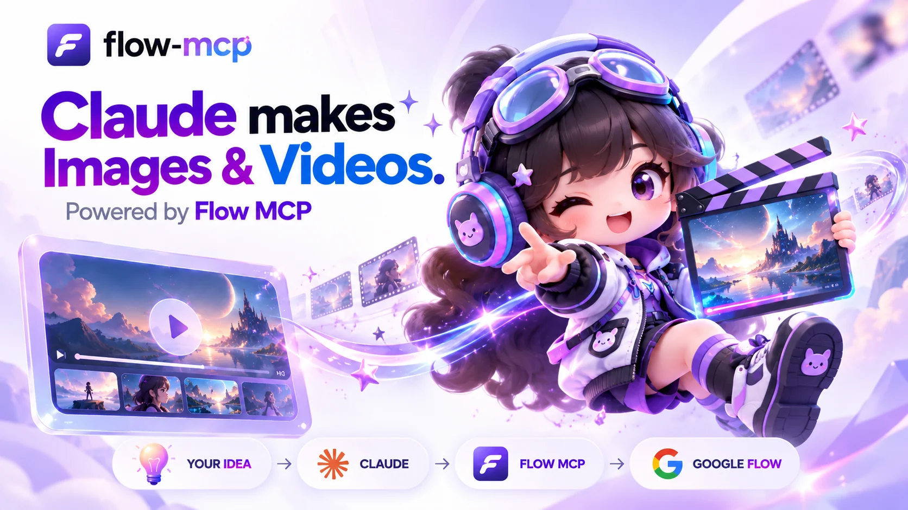
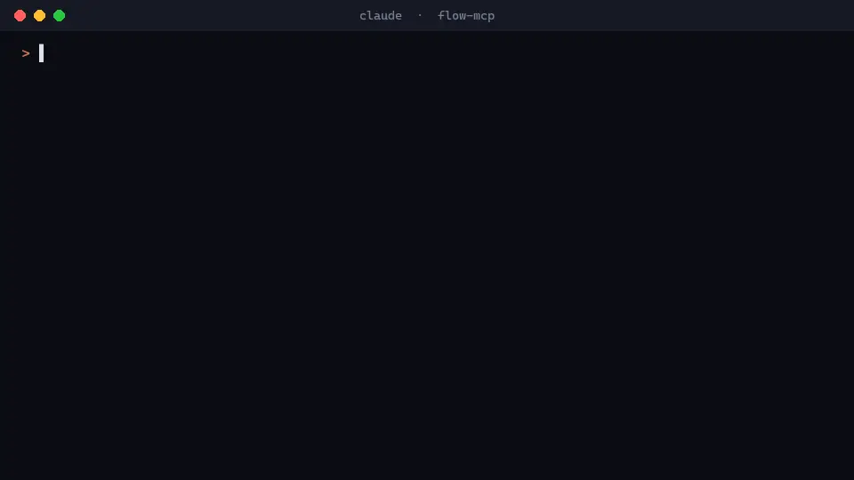
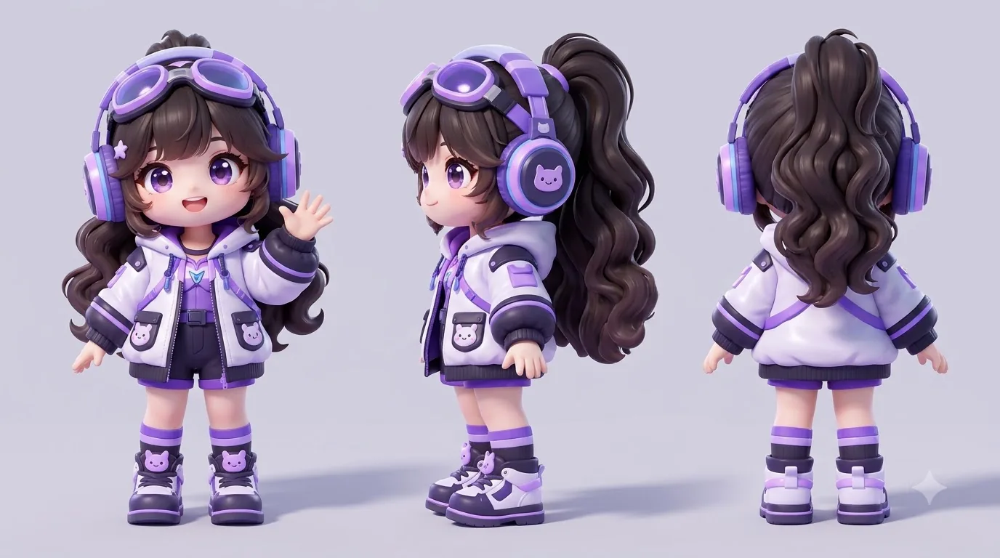
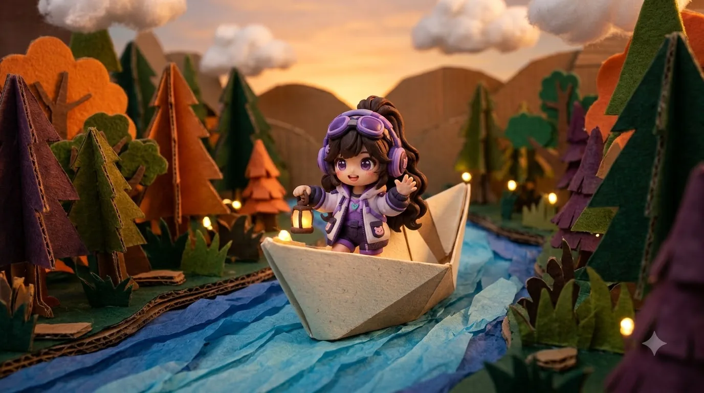

# flow-mcp 🎬 — Google Flow MCP server for Claude, Cursor and VS Code

<p align="center">
  
</p>

<p align="center">
  <a href="https://www.npmjs.com/package/@parthmax/flow-mcp"></a>  <a href="https://nodejs.org"></a>
  <a href="https://modelcontextprotocol.io"></a>
  <a href="LICENSE"></a>
</p>

flow-mcp is an open-source MCP server that lets your AI assistant make images and videos with
[Google Flow](https://flow.google.com). Ask Claude Code, Cursor, VS Code or Claude Desktop in plain words
and it generates and edits **Nano Banana** images, makes **Veo 3.1** and **Omni** videos, upscales to 2K,
keeps a character consistent across shots, and works with Flow's creative agent.

**Your account, your credits, no catch.** flow-mcp drives Flow in a Chrome window signed in to your own
Google account, on your own computer. No API key, no server in between, no extra subscription. Images are
free, and videos only run within the credit budget you set.

[Getting started](docs/getting-started.md) · [Usage](docs/usage.md) · [Gallery](#made-with-flow-mcp) · [Capabilities](CAPABILITIES.md) · [Troubleshooting](docs/troubleshooting.md) · [Security](docs/security.md) · [npm](https://www.npmjs.com/package/@parthmax/flow-mcp)

<p align="center">
  
</p>

## Install

You need [Node.js](https://nodejs.org) 22+ and Google Chrome. A free Google account works: it gets 50 Flow
credits a day.

```bash
npx -y @parthmax/flow-mcp setup
```

A Chrome window opens on Flow; sign in to Google once. `setup` then offers to connect Claude Code and
install the flow-director skill, and prints the config for Cursor, VS Code and Claude Desktop. Restart
your AI client afterwards.

Or let your assistant do it. Paste this to Claude Code:

> Set up the Google Flow MCP server for me: run `npx -y @parthmax/flow-mcp setup --connect`. A Chrome
> window will open; tell me to sign in to Google there. When it is done, tell me to restart you.

Client configs and running from source are in [Getting started](docs/getting-started.md).

## Quick start

Ask your assistant:

```text
make an image of a lighthouse at dusk
edit my photo C:\photos\me.jpg into a winter scene
make an 8 second video of a paper boat, max 10 credits
```

A Chrome window shows Flow doing the job; leave it open. Files are saved to `~/.flow-mcp/output`. If
something fails, `npx -y @parthmax/flow-mcp status` names the problem and the fix.

## Made with flow-mcp

Everything below was made by an AI assistant through flow-mcp, from one mascot reference. The images were
free and the video cost 10 credits. Same character in every shot, thanks to a character sheet and Flow's
references.

<table>
  <tr>
    <td colspan="2"><a href="assets/flo-action.mp4"></a><br><sub><b>Image to video</b> · Veo 3.1 Lite, 8 s with sound, 10 credits, started from the studio image below · <a href="assets/flo-action.mp4">play with sound (mp4)</a></sub></td>
  </tr>
  <tr>
    <td colspan="2"><br><sub><b>Character sheet</b> · one reference image in, a consistent front, side and back turnaround out</sub></td>
  </tr>
  <tr>
    <td width="50%"><br><sub><b>Text to image</b> · "Flo directing a film in a neon studio"</sub></td>
    <td width="50%"><br><sub><b>Same character, new style</b> · claymation on a paper boat</sub></td>
  </tr>
  <tr>
    <td width="50%"><br><sub><b>Before</b> · "Flo at a lighthouse at dusk"</sub></td>
    <td width="50%"><br><sub><b>After</b> · "turn it into a snowy winter night", same pose and composition</sub></td>
  </tr>
</table>

## How it fits together

- The **MCP server** (`flow-mcp serve`) runs on your computer and gives your assistant [18 Flow tools](docs/usage.md#mcp-tools):
  images, videos, upscaling, characters, projects, credits and Flow's agent chat.
- A **Chrome window** with its own profile stays signed in to your Google account. flow-mcp drives Flow's
  own page there, so Flow handles sign-in and verification as it does for you.
- **Projects** keep each piece of work together: Flow's agent remembers it, and local files upload once and
  are reused.
- The **flow-director skill** plans shots, previews everything as free images, then spends credits once
  the plan is right.

See [How it works](docs/how-it-works.md) for the details.

## Credits and safety

Images, edits and 2K upscales are free. For videos, Flow's agent quotes a price first, and flow-mcp
approves only within your `max_credits` (default 10). It never picks "Always approve" and never retries a
paid generation. An 8 s Veo 3.1 Lite video costs 10 credits on a free account (October 2026).

> **Alpha, unofficial.** Tested on Windows with an English-language Flow account. Automating the Flow
> website may be against Google's terms, and the local control port can act as your Google account. Read
> [Security and risks](docs/security.md) first. Not affiliated with Google.

## Documentation

| Goal | Start here |
|---|---|
| Install and connect a client | [Getting started](docs/getting-started.md) |
| Make images and videos, manage credits | [Usage](docs/usage.md) · [Capabilities](CAPABILITIES.md) |
| Get better results from Veo and Nano Banana | [flow-director skill](skills/flow-director/SKILL.md) |
| Change folders, ports, or Google accounts | [Configuration](docs/configuration.md) |
| Fix a problem | [Troubleshooting](docs/troubleshooting.md) |
| Understand the risks | [Security and risks](docs/security.md) |
| Learn how it is built | [How it works](docs/how-it-works.md) |
| Give an AI the project summary | [llms.txt](llms.txt) |

## Development

```bash
git clone https://github.com/parthmax2/flow-mcp.git
cd flow-mcp
npm install
npm run build
npm test
```

Coding agents working on this repo: read [AGENTS.md](AGENTS.md).

## Community

Use [GitHub issues](https://github.com/parthmax2/flow-mcp/issues) for bugs and feature requests. If Flow's
website changed and something broke, include the `status` output. Fixes, macOS and Linux testing, and new
tools are welcome as pull requests.

Built and maintained by **Saksham Pathak** ([Parthmax](https://github.com/parthmax2)):
[parthmax.in](https://parthmax.in) · [LinkedIn](https://linkedin.com/in/sakshampathak) · [Hugging Face](https://huggingface.co/parthmax)

## License

MIT. See [LICENSE](LICENSE). Google and Google Flow are trademarks of Google LLC.
